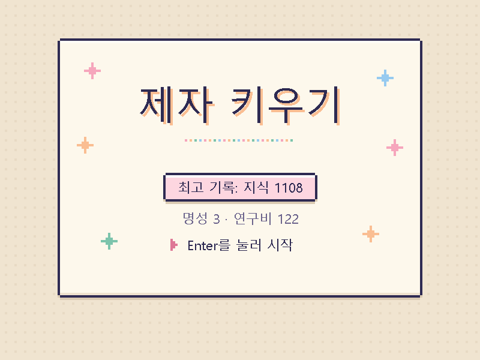
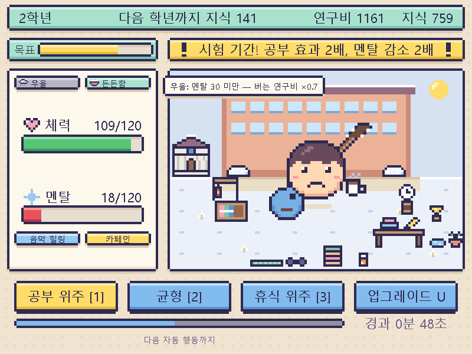
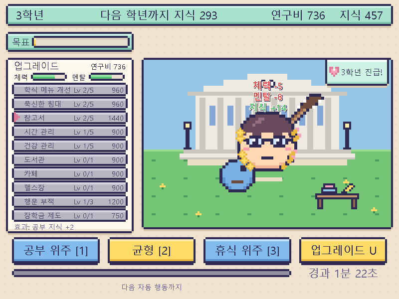
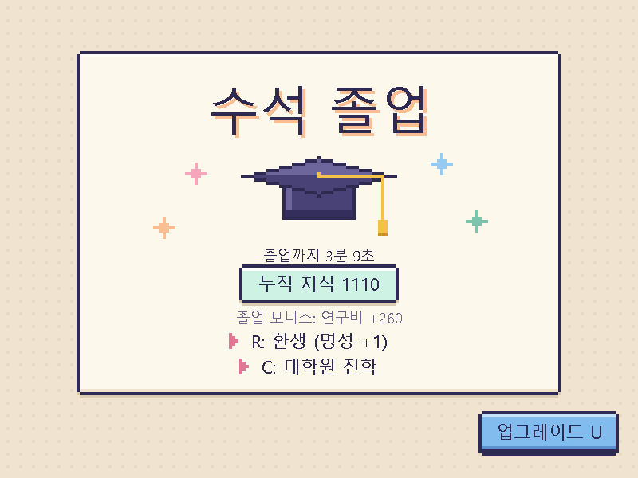

# 제자 키우기

> 과목명: 파이썬_기초실습 · 학번: 2602110263 · 이름: 조다운 · 제출일: 2026-11-26

## 바로가기

| 보고 싶은 것 | 위치 |
|---|---|
| 게임 규칙과 수치(기획서) | [docs/기획서.md](docs/기획서.md) — 저장소 화면에서 바로 읽을 수 있습니다 |
| 실행 파일(Windows) | [Releases 페이지](https://github.com/Dawoon09/python-final-project/releases)에서 가장 위 버전의 **Assets → `main.exe`**를 내려받아 더블클릭합니다. Python 설치는 필요 없습니다. 바로 받기: [v0.10.0 main.exe](https://github.com/Dawoon09/python-final-project/releases/download/v0.10.0/main.exe) |
| 소스에서 직접 실행 | 아래 [2. 실행 방법](#2-실행-방법) |

> 처음 실행할 때 Windows SmartScreen 경고가 뜨면 "추가 정보 → 실행"을 누르세요. 개인이 만든 프로그램이라 서명이 없어서 나오는 경고입니다. 최고 기록과 하던 판은 `main.exe`와 같은 폴더의 `record.json`에 저장됩니다.

## 1. 게임 소개

「제자 키우기」는 플레이어가 교수가 되어 신입생 제자 한 명을 1학년부터 졸업까지 돌보는 pygame **방치형 육성 게임**입니다. 판에 **시간 제한이 없습니다.** 제자가 공부해 모은 **누적 지식(학점)**으로 학년이 오르고, 졸업까지 **걸린 시간**이 짧을수록 좋은 등급으로 졸업합니다. 이미지·사운드 없이 `pygame.draw`의 도형만으로 모든 화면을 그립니다.

제자는 2초마다 **스스로** 쉬고, 밥을 먹고, 공부합니다. 플레이어는 버튼을 연타하는 대신 **일과표 방침**을 정하고, 공부로 번 **연구비**로 **업그레이드**를 사서 제자를 점점 더 잘 키웁니다. 졸업한 뒤에는 새 신입생으로 **환생**하거나 같은 제자로 **대학원**에 가서 끝없이 버틸 수 있습니다.

### 규칙 요약

- **게이지:** 체력·멘탈(시작 80, 기본 최대 100)은 1초마다 1씩 줄고, 둘 중 하나가 0이 되면 즉시 **휴학** 엔딩입니다. 회복은 휴식에서만 되고, 학식은 체력 감소를 줄이는 버프 '든든함'을 줍니다.
- **자동 행동:** 체력·멘탈이 방침의 회복 기준 미만이면 휴식, 든든함이 없으면 학식, 아니면 공부합니다. 방침은 공부 위주(빠르지만 위험) / 균형 / 휴식 위주(느리지만 안전, 연구비 보너스) 세 가지입니다.
- **진급과 졸업:** 누적 지식 400 / 900 / 1500이면 2·3·4학년, 4학년에서 2200이면 졸업입니다. 걸린 시간이 290초 이하면 수석, 720초 이하면 무사, 그보다 길면 아슬아슬 졸업입니다.
- **60초 주기:** 계절·낮밤이 바뀌고, 주기의 마지막 15초는 시험 기간(공부 지식 2배, 멘탈 감소 2배)입니다.
- **디버프와 버프:** 피곤·우울(게이지 30 미만), 든든함(학식), 컨디션 좋음(휴식 위주에서 체력·멘탈 70 이상)이 상태 배지로 보이고, 마우스를 올리면 효과가 뜹니다.
- **성장:** 지식이 오르면 연구비가 쌓이고, U로 여는 패널에서 업그레이드 14종(행동 효율·자동화 속도·시설·이벤트·컨디션·연구비)을 삽니다. 산 업그레이드는 다음 판에도 남고 무대에 장식으로 보입니다.
- **졸업 후:** R로 환생(명성 +1, 연구비 배수 상승, 명성에 따라 시간강사 → 조교수 → 부교수 → 정교수 → 명예교수 칭호)하거나 C로 대학원에 진학합니다. 대학원은 연구비를 많이 주지만 오래 버틸수록 빨리 지칩니다.
- **랜덤 이벤트:** 자동 행동 직후 대학 생활 이벤트가 일어나고, 선택에 따라 특성·외형·연계 이벤트가 남습니다.

정확한 수치와 표는 [기획서](docs/기획서.md)에 있습니다: 게임 규칙 2절, 연구비·업그레이드·환생·대학원 3절, 이벤트 4절, 화면 6절, 기능 목록 7절, 개발 과정 8절, 밸런스 10절, 바뀐 과정은 부록 "변경 이력".

## 2. 실행 방법

필요 환경: Windows 10/11, Python 3.12, pygame 2.6

```
pip install -r requirements.txt
python main.py
```

PC에 다른 버전의 Python도 설치되어 있다면 3.12를 지정해서 실행합니다.

```
py -3.12 -m pip install -r requirements.txt
py -3.12 main.py
```

빌드한 실행 파일이 있다면 `dist/main.exe`를 더블클릭해도 됩니다(Python 불필요).

## 3. 조작법

| 조작 | 마우스 | 키보드 | 화면 |
|---|---|---|---|
| 게임 시작 | - | Enter | 타이틀 |
| 새 게임 (Enter는 이어하기: 하던 판이 있으면 그 판부터, 업그레이드·연구비·명성 유지 / N은 하던 판·업그레이드·연구비·명성 모두 0, 최고 기록은 유지) | - | N → 확인 상자에서 Y (취소: N 또는 Backspace) | 타이틀 |
| 방침: 공부 위주 | "공부 위주" 버튼 클릭 | 1 | 게임 |
| 방침: 균형 | "균형" 버튼 클릭 | 2 | 게임 |
| 방침: 휴식 위주 | "휴식 위주" 버튼 클릭 | 3 | 게임 |
| 업그레이드 패널 열기·닫기 | [업그레이드 U] 버튼 클릭 | U | 게임·엔딩 |
| 이벤트 로그 열기·닫기 | - | L | 게임 |
| 업그레이드 고르기·사기 | 항목 클릭 | ↑↓로 고르고 Enter | 패널이 열렸을 때 |
| 툴팁 보기 | 업그레이드 항목·상태 배지·특성 배지·정보바 학년/연구비·체력/멘탈 라벨에 마우스 올리기 | - | 게임·엔딩 |
| 이벤트 선택지 고르기 | 선택지 클릭 | 1 / 2 | 선택지형 이벤트 |
| 환생 (졸업·대학원 수료) / 다시 하기 (휴학) | - | R | 엔딩 |
| 대학원 진학 | - | C | 졸업 엔딩 |
| 게임 종료 | 창 닫기 버튼 | ESC | 모든 화면 |

## 4. 폴더 구조

```
.
├── main.py          # 실행 진입점
├── config.py        # 모든 수치·좌표·색·문구 상수, 업그레이드·이벤트 표, 도트 스프라이트, record.json 경로
├── student.py       # Student: 게이지, 자연 감소, 행동, 디버프·버프, 진급·대학원, 엔딩 판정, 제자 그리기
├── button.py        # Button: 버튼 위치·글자·클릭 판정 + 도트 그리기 도우미
├── game.py          # Game: 메인 루프, 화면 전환, 자동 행동·방침, 이벤트, 연구비·업그레이드, 환생·대학원, 기록, 배경·연출
├── tests/           # pytest 검수 테스트 (conftest.py: 화면 없는 실행, 임시 기록 파일)
├── docs/            # 기획서.md(기준 문서), images/(README 스크린샷)
├── requirements.txt
├── CLAUDE.md        # 개발 규칙 (AI 개발 도구용)
├── .claude/         # 개발에 쓴 스킬(jeja-spec, build-exe)과 에이전트(개발팀, 검수팀)
└── src/, data/, pyproject.toml   # 과제 저장소 템플릿에 원래 있던 파일
```

## 5. 테스트

```
py -3.12 -m pytest
```

화면 없이(`SDL_VIDEODRIVER=dummy`) 게이지·행동·방침, 진급·졸업 경계값, 시험 기간, 업그레이드 가격과 효과, 이벤트, 환생·대학원, 기록 저장, 화면 배치 등을 검사합니다. 테스트 중 기록 파일은 임시 폴더에 저장되어 실제 `record.json`에는 영향을 주지 않습니다.

- 전체 테스트는 약 3분 걸립니다.
- `tests/test_final.py::test_dist_exe_exists_not_run`은 빌드한 `dist/main.exe`가 있어야 통과합니다(6절로 먼저 빌드).
- 프레임 시간 검사(`test_idle_k.py`)는 다른 무거운 프로그램이 함께 돌면 실패할 수 있습니다.

## 6. 빌드 방법 (Windows 실행 파일)

```
py -3.12 -m pip install pyinstaller
py -3.12 -m PyInstaller --onefile --noconsole main.py
```

- 결과물: `dist/main.exe` (파일 하나). `build/`, `main.spec`은 중간 산출물이며 커밋하지 않습니다.
- `record.json`은 exe와 **같은 폴더**에 저장됩니다(Python으로 실행하면 `main.py` 폴더).
- exe가 바로 꺼지면 `--noconsole`을 빼고 다시 빌드해 콘솔에서 오류를 확인합니다. 자세한 내용은 [build-exe 스킬](.claude/skills/build-exe/SKILL.md).

## 7. 결과 및 회고

### 실행 화면

실제 게임을 실행해 찍은 화면입니다(800×600).

| 타이틀 | 게임 (2학년, 시험 기간) |
|---|---|
|  |  |
| **업그레이드 패널과 툴팁 (3학년)** | **졸업 엔딩** |
|  |  |

### 어려웠던 점과 해결 방법

- **게임 밸런싱.** 업그레이드 가격, 졸업 기준, 방침별 회복·소모량을 어느 정도로 해야 "적당한지" 감으로는 알 수 없었습니다. 한 판이 몇 분씩 걸려 직접 해 보는 것만으로는 비교가 어려워, 같은 시드 30개를 돌리는 시뮬레이션으로 평균 졸업 시간, 휴학 비율, 수석 비율을 표로 비교했습니다. 업그레이드 없는 첫 판에서 공부 위주 방침이 30판 중 17판이나 수석이 되는 문제를 발견해, 수석 기준을 330초에서 290초로 낮추고 이벤트 수치를 조정했습니다(수석 2판으로 감소). "업그레이드 없이는 첫 판이 무사 졸업, 업그레이드를 모으면 수석"처럼 목표를 먼저 정하고 수치를 맞췄습니다.
- **심심하지 않게 만들기.** 제자가 알아서 행동하는 방치형이라 플레이어가 할 일이 적어 금방 지루해졌습니다. 그래서 변화가 계속 생기도록 랜덤 이벤트와 선택지, 선택에 따라 남는 특성·외형, 연구비로 사는 업그레이드(무대 장식이 레벨마다 늘어남), 졸업 뒤 환생과 명성 칭호, 오래 버틸수록 힘들어지는 대학원, 계절·낮밤·시험 기간을 넣었습니다. "이게 있으면 다음 목표가 생기는가"를 기준으로 남길지 정했습니다.
- **UI의 가독성.** 보여 줄 정보가 늘수록 화면이 복잡해졌습니다. 평소에는 상태 배지와 목표 막대만 보이게 하고, 자세한 배수와 변화량은 마우스를 올렸을 때 툴팁으로 보이게 했습니다. 툴팁이 정보바나 방침 버튼을 가리지 않도록 위치와 크기를 정했고, 글자 크기도 읽기 편한 16px로 맞췄습니다. 학년이 오를수록 커지던 캐릭터 머리가 4학년에서 너무 커 보여, 모든 학년을 같은 크기로 고정하기도 했습니다.
- **이벤트·업그레이드의 효과와 상호작용.** 효과가 하나씩은 단순해도, 여러 개가 겹치면 결과가 복잡해졌습니다. 예를 들어 휴식 회복량은 기본값에 특성, 카페, 푹신한 침대가 더해지고 그다음 방침 배수가 곱해집니다. 연구비 배수도 명성, 대학원 년차, 연구 과제 수주, 컨디션이 곱해집니다. 이 계산 순서를 정하고 기획서에 표로 정리해 두었고, 툴팁에 "지식 1당 연구비 5.85배"처럼 합계와 구성 요소를 보여 주어 플레이어도 겹친 효과를 이해할 수 있게 했습니다. 이벤트 수치를 바꿀 때는 특성과 업그레이드가 만드는 결과를 다시 시뮬레이션으로 확인했습니다.

### 개선할 점

- **밸런스를 더 다듬기.** 시뮬레이션은 선택지를 항상 첫 번째로 고르는 단순한 플레이어를 기준으로 했습니다. 실제 사람이 하는 플레이로 더 시험해 보고, 효과가 눈에 덜 띄는 업그레이드도 쓸모가 느껴지도록 다듬고 싶습니다.
- **더 오래 즐길 만한 소소한 콘텐츠.** 만든 이의 실제 있었던 대학 생활 에피소드를 이벤트로 넣는 것처럼, 게임에 개성과 이야기를 더하는 소소한 콘텐츠를 추가하고 싶습니다.
